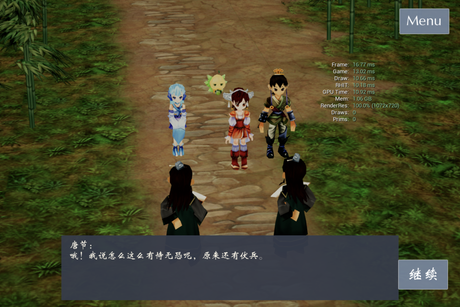

# SharpDemo = UE5 + UnrealSharp + Pal3.Unity

SharpDemo 是 **UnrealSharp Mono 运行时移植**的配套验证工程，目标是让 UE5 项目里的 C# 代码也能在 Android、iOS 等移动平台上运行。项目把 Pal3.Unity 移植到 UE5，用实际游戏流程验证 Mono 宿主、C# 与 UE 绑定、托管程序集发布与打包、调试和运行时诊断，也用于验证移动端 CoreCLR 的适配。 [UnrealSharp 上游仓库](https://github.com/UnrealSharp/UnrealSharp)

[](Docs/images/pal3-android.png)

## 为什么选择 UnrealSharp

- **强类型的 C# 脚本。** 编辑器和编译器能在运行前发现语法错误、类型不匹配，以及接口签名变化引起的调用错误。Lua 和 JavaScript 的动态类型检查通常发生在运行时。
- **成熟的开发和调试工具链。** Visual Studio、Rider 和 VS Code 都支持 C# 开发，可以用 .NET SDK 构建，并使用自动补全、重构、断点、单步和调用栈检查。嵌入式 Lua 的断点调试依赖宿主或外部工具，QuickJS 可通过社区调试适配器接入 IDE。
- **高性能的运行时和跨语言调用。** .NET 的 JIT 可将 IL 编译成原生机器码，Mono 解释器也能在限制动态代码生成的平台执行 IL。UnrealSharp 在构建时静态生成 UE API 的 C# glue，并通过 `delegate* unmanaged` 函数指针直接调用原生绑定入口，减少 C# 与 C++ 之间高频调用的动态查找和分发开销。
- **已有引擎和游戏验证。** Unity、Godot 和 Flax Engine 都支持 C# 脚本，MonoGame 也用于《星露谷物语》等商业游戏。

UE 商业游戏也有相关实践。CSharpLoader 项目记录了《黑神话：悟空》PC 版通过 USharp 运行部分 C# 游戏逻辑。《鸣潮》3.6 的官方公告披露了编程语言切换，社区实测记录了客户端的 C# 环境。

## 为什么选择 Pal3.Unity

- **规模适合反复测试。** 它是一套完整的 RPG 工程，场景加载、剧情脚本、角色动画、输入、音频、过场、UI 和存读档能在一次游戏流程中覆盖多个引擎子系统。按场景和剧情节点运行，也方便定位单项问题。
- **有可运行的 Unity 版本作对照。** 可以用同一套游戏数据运行相同的场景和剧情，对照角色动作、镜头、交互和画面，及时发现 UE 移植引入的差异。 [Pal3.Unity 上游工程](https://github.com/0x7c13/Pal3.Unity)
- **分层清晰，便于跨引擎移植。** `Pal3.Core` 处理资源格式和脚本指令，`Pal3.Game` 实现玩法，`Engine` 抽象实体、变换、贴图等引擎能力。SharpDemo 优先复用上游 C# 玩法，把 Unity 与 UE 的差异集中到引擎适配层，减少后续同步上游代码的成本。 [上游代码复用设计](Docs/PAL3_PORTABILITY.md)

## 运行时与平台

| 运行环境 | 当前默认运行时 |
|---|---|
| UE 编辑器，包括 PIE 和由编辑器启动的 `-game` | Mono，由 `DotNetRuntimeEditor=Mono` 指定 |
| Win64 打包游戏 | CoreCLR |
| Android 和 iOS 打包游戏 | Mono |

编辑器运行时和目标平台运行时分别选择。当前默认配置见 [DefaultEngine.ini](Config/DefaultEngine.ini)，移动端 CoreCLR 的适配与组合验证见[运行时记录](Docs/rebuild/DOTNET-SDK-UNIFICATION-PLAN.md)。Windows Android 打包入口是 [BuildAndroid.bat](BuildAndroid.bat)。本轮 PAL3 玩法回归以 Win64 编辑器和独立游戏为基准，运行时验证记录与 PAL3 玩法验收分别维护。

## 工程结构

| 目录 | 职责 |
|---|---|
| `Script/Pal3.Core`、`Script/Pal3.Game` | 原版资源格式、脚本指令和玩法。对照本机 PAL3.Unity 的 `Assets/Scripts` |
| `Script/Engine`、`Script/UnityEngine`、`Script/Pal3.Game/Stubs` | 引擎抽象、Unity 兼容、实体与生命周期桥接 |
| `Script/ManagedSharpDemo` | UE 侧启动和逐帧驱动、PAL3 菜单、HUD 与自动化入口 |
| `Source/RuntimeWidgetLayout`、`Source/SharpDemo` | JSON UMG 和网格、资源、音频等原生接口 |
| `Plugins/UnrealSharp` | 独立 Git 子模块，负责托管运行时、UE 绑定生成和跨语言调用 |

## Windows 开发启动

- 准备与项目关联的 UE 源码构建、UnrealSharp 子模块及其运行时 SDK、可用的 .NET 10 SDK。托管项目目标为 `net10.0`，编辑器使用 `DotNetRuntimeEditor=Mono`。
- 从原版游戏安装目录读取 PAL3 数据。启动 UE 前设置 `PAL3_DATA_PATH`，指向包含游戏资源的安装根目录。
- macOS 调试时默认读取项目的 `Saved/PAL3`，也可以把该目录设为指向 Steam 游戏目录的符号链接。如果那里没有 `basedata/basedata.cpk`，则读取 `~/Library/Application Support/Steam/steamapps/common/PAL3`。
- Android 默认读取内部共享存储的 `Download/PAL3`。保留原版的目录结构和文件名大小写，例如 `Download/PAL3/basedata/basedata.cpk`。首次启动缺权限时，点击「去授权」，在 Android 11 及以上的系统设置中开启「所有文件访问权限」。返回游戏后会重新检查。缺少数据文件时，补齐后点击「重试」。
- iOS 启动时如果还没找到数据，可点「选择 PAL3 文件夹」，在系统文件选择器的「下载」中选中已下载到本机的 `PAL3`。保留 `basedata`、`scene`、`music` 等目录。游戏会记住授权并原地读取 CPK，也支持直接读取「我的 iPad/iPhone → SharpDemo → PAL3」。
- 新检出还需要本地托管依赖。在 `Script/Pal3.Core/Libraries` 放入 `Newtonsoft.Json.dll` 和 `INIFileParser.dll`。它们未纳入仓库，可从本地 PAL3.Unity 的 `Assets/Packages` 中取 `Newtonsoft.Json.13.0.3` 和 `ini-parser-netstandard.2.5.2` 的 `lib/netstandard2.0` 版本。

在项目根目录的 PowerShell 运行，路径按本机环境调整。

```powershell
git submodule update --init --recursive
$project = (Resolve-Path .\SharpDemo.uproject).Path
$ue = 'D:\Code\UE5\Engine'
$env:PAL3_DATA_PATH = 'E:\Program Files (x86)\Steam\steamapps\common\PAL3'

& "$ue\Build\BatchFiles\Build.bat" SharpDemoEditor Win64 Development "-Project=$project" -WaitMutex
if ($LASTEXITCODE -ne 0) { throw 'SharpDemoEditor build failed' }

# 从 Script 运行 dotnet，以使用该目录的 global.json。
Push-Location .\Script
try {
    # 若增量生成遗漏了 RuntimeWidgetLayout.dll，或 JSON UMG 接口的绑定过期，先单独发布该 glue。
    # dotnet publish ..\Intermediate\UnrealSharp\UHT\Editor\RuntimeWidgetLayout\RuntimeWidgetLayout.csproj -c Release -p:UETargetType=Editor -o ..\Binaries\Managed\net10.0
    dotnet publish .\ManagedSharpDemo\ManagedSharpDemo.csproj -c Release -p:UETargetType=Editor -o ..\Binaries\Managed\net10.0
    if ($LASTEXITCODE -ne 0) { throw 'Managed publish failed' }
} finally {
    Pop-Location
}

& "$ue\Binaries\Win64\UnrealEditor.exe" $project -game -RCWebControlEnable -log
```

也可用同一编辑器打开 `SharpDemo.uproject`，在默认地图 `LV_Pal3` 开始 PIE。单改托管代码时可从发布步骤开始。改原生 `UFUNCTION` 时，先关闭占用该模块的编辑器或测试进程，再重新构建原生模块并发布托管代码。正常启动会看到 PAL3 标题菜单。

多开编辑器时先发布一次托管程序集，再给用于测试的编辑器实例传入 `-UnrealSharpSkipManagedBuild`。用 Visual Studio F5 启动时，将它追加到调试命令参数中。该实例会加载现有程序集，并跳过启动编译和 C# 热重载。

要在 Visual Studio 同时查看 UE 和 PAL3 的 C++、C# 代码，先生成 UE 解决方案，再从项目根目录运行 `dotnet run --project tools/MergeScriptSln -- SharpDemo.sln`，然后打开 `SharpDemo.mixed.sln`。输入也可以用 `SharpDemo.slnx`，此时输出为 `SharpDemo.mixed.slnx`。选 `SharpDemo` 为启动项目，用 `Development Editor | Win64` 启动。

PAL3 的宿主地图、材质和字体资产放在 `Content/PAL3`，由 `DefaultGame.ini` 的 `DirectoriesToAlwaysCook` 指定 Cook 目录。JSON-UMG 默认字体在同一文件的 `[RuntimeWidgetLayout.Fonts]` 中配置，目前指向方正魏碑。其他机器可将字体文件命名为 `Pal3Weibei.ttf`，在编辑器中导入 `Content/PAL3/Fonts`，并选择同时创建 Font 资产。未导入时使用 UE 默认字体。

Windows 和 Android 在首次播放原版过场时，将视频在运行时转成 MP4，写入 `Saved/Movies` 后播放。iOS 将 `PAL3/movie` 下预先转换的 MP4 缓存到 `Saved/Movies/Imported` 后播放。

启动前设置 `PAL3_AUTOSTART=1` 或传入 `-PAL3Autostart`，可跳过标题菜单，直接进入开场并启用自动对白。

## 玩法与调试入口

| 操作 | 入口 |
|---|---|
| 开始、选剧情、切场景、读档 | 标题菜单或可操作状态下的 Tab 菜单。切场景在当前 UE 世界内加载 PAL3 地图 |
| 移动、交互、继续对白 | WASD 或方向键、E、Space 或 Enter。当前交互目标上方会显示提示 |
| 镜头 | Q/R、鼠标滚轮或手柄右摇杆横向转动。固定室内机位和剧情镜头按原作锁定 |
| 移动端操作 | 左下角摇杆移动，右下角「镜头」摇杆横向转动。右下角动作键在自由行动时显示「交互」，在剧情中显示「继续」。右上角 Menu 可开启「摇杆全透明」，触控区仍可操作。Win64 可用 `PAL3_TOUCH_STICK=1` 预览 |
| 返回、诊断、自动对白 | Esc 返回上一级或关闭菜单。Tab 菜单可开关诊断面板和自动对白 |
| 存档 | 左侧滚动选择槽位。可操作且没有运行脚本时可写手动槽 1–99。槽 0 为自动存档，统一读写 `Saved/Saves` |
| 自动化 | `tools/pal3-play.ps1` 通过 RC 或本地文件调用同一套游戏命令。移动使用游戏命令直接驱动 |

主菜单的静态 JSON 定义首页和剧情两个 `WidgetSwitcher` 页面。场景页面按挂载的 PAL3 场景档案分组，调试跳转从导航数据选择可行走的落点。存读档页面按槽位数量生成。独立布局文件通过 UFS 随 UE 打包，运行时由 UE 文件接口按项目相对路径读取。C# 负责交互与数据，`RuntimeWidgetLayout` 提供通用的布局、换页和控件 API。诊断面板和对白栏由 `Pal3Hud` 使用 JSON UMG 呈现。旧 `UPal3DebugOverlay` 类仍承载 RC 查询和程序网格接口。[主菜单布局](Script/ManagedSharpDemo/Layouts/Pal3StartMenu.json)
