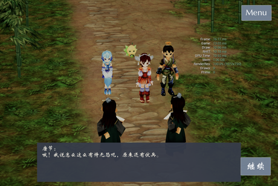

# SharpDemo = UE5 + UnrealSharp + Pal3.Unity

[简体中文](README.md) | English

[Download the Android APK (v0.0.2)](https://github.com/RPG3D/Pal3.Unreal/releases/tag/v0.0.2)

SharpDemo is the companion project for the **UnrealSharp mobile port**, used to validate UnrealSharp on Android, iOS, and other mobile platforms. It ports Pal3.Unity to UE5 and uses actual PAL3 (仙剑奇侠传三) gameplay to validate runtime hosting, C# bindings to UE, managed assembly publishing and packaging, debugging, and diagnostics. The project also supports work on mobile CoreCLR integration. [Upstream UnrealSharp](https://github.com/UnrealSharp/UnrealSharp)

[](Docs/images/pal3-android.png)

## Why UnrealSharp

- **Strongly typed C# scripting.** The editor and compiler can catch syntax errors, type mismatches, and calls broken by API signature changes before the game runs. Lua and JavaScript generally perform dynamic type checks at runtime.
- **Established development and debugging tools.** C# can be built with the .NET SDK. Visual Studio, Rider, and VS Code with C# extensions provide navigation, refactoring, breakpoints, and call-stack inspection. Mixed C++/C# debugging support depends on the IDE, platform, and runtime. IDE debugging for embedded Lua and JavaScript running in QuickJS in UE depends on the host or plugin and typically requires additional integration and configuration for breakpoints, stepping, and variable inspection.
- **Runtime and interop performance.** The .NET JIT compiles IL to native machine code, while the Mono interpreter can execute IL on platforms that restrict dynamic code generation. UnrealSharp generates C# glue for UE APIs at build time and uses `delegate* unmanaged` function pointers to call native binding entry points, reducing dynamic lookup and dispatch overhead in frequent C#–C++ calls.
- **Experience from existing engines and games.** Unity, Godot, and Flax Engine support C# scripting. Commercial games also use C#. The PC version of Black Myth: Wukong uses USharp to run part of its C# gameplay logic. Wuthering Waves 3.6 switched its client scripting layer to C#. [CSharpLoader project notes](https://github.com/czastack/B1CSharpLoader/blob/master/README.md) · [Geekerwan's hands-on analysis](https://www.bilibili.com/video/av117353606022815/)

## Why Pal3.Unity

- **A practical workload for repeated testing.** An RPG sequence exercises scene loading, story scripts, character animation, input, audio, cutscenes, UI, and saving and loading. Debugging can start at the relevant scene or story checkpoint.
- **A working Unity version for comparison.** The same game data, scenes, and story sequences can be run in Unity to compare animation, cameras, interactions, and rendering, making differences introduced by the UE port easier to find. [Upstream Pal3.Unity](https://github.com/0x7c13/Pal3.Unity)
- **An elegant, layered architecture for cross-engine portability.** `Pal3.Core` handles resource formats and script commands, `Pal3.Game` implements gameplay, and `Engine` abstracts entities, transforms, textures, and other engine capabilities. SharpDemo reuses the upstream C# gameplay code and handles Unity–UE differences in the engine adapters, helping keep future upstream updates manageable. [Code reuse and portability design](Docs/PAL3_PORTABILITY.md)

## Runtimes and platforms

| Environment | Current default runtime |
|---|---|
| UE editor process, including PIE and `UnrealEditor -game` | Mono, selected by `DotNetRuntimeEditor=Mono` |
| Packaged Win64 game | CoreCLR |
| Packaged Android and iOS games | Mono |

The editor and packaged game can select their runtimes independently. See [DefaultEngine.ini](Config/DefaultEngine.ini) for configuration and the [runtime notes](Docs/rebuild/DOTNET-SDK-UNIFICATION-PLAN.md) for mobile CoreCLR integration and validation. Use [BuildAndroid.bat](BuildAndroid.bat) to package an Android APK on Windows.

## Project structure

| Directory | Responsibility |
|---|---|
| `Script/Pal3.Core`, `Script/Pal3.Game` | Original game resource formats, script commands, and gameplay. Corresponds to `Assets/Scripts` in Pal3.Unity |
| `Script/Engine`, `Script/UnityEngine`, `Script/Pal3.Game/Stubs` | Engine abstractions, Unity compatibility, and entity and lifecycle adapters |
| `Script/ManagedSharpDemo` | UE-side startup and frame updates, PAL3 menus, HUD, and automation entry points |
| `Source/RuntimeWidgetLayout`, `Source/SharpDemo` | Native APIs for JSON UMG, meshes, resources, audio, and related features |
| `Plugins/UnrealSharp` | Separate Git submodule for the managed runtimes, UE binding generation, and interop |

## Original PAL3 game data

You need your own original PAL3 game data. Preserve the `basedata`, `scene`, `music`, and other directories, including the case of directory and file names.

- **Windows** — Set `PAL3_DATA_PATH` to the original game's installation root before launching.
- **macOS** — Development builds first look in the project's `Saved/PAL3` directory, which can be a symbolic link to the Steam installation. If `basedata/basedata.cpk` is missing there, the game checks `~/Library/Application Support/Steam/steamapps/common/PAL3`.
- **Android** — The game reads directly from `Download/PAL3` in shared storage, for example `Download/PAL3/basedata/basedata.cpk`. On first launch, select the permission button (`去授权`). Enable “All files access” on Android 11 and later, or grant storage-read permission on earlier versions. After adding any missing data files, select Retry (`重试`).
- **iOS** — Place the data in “On My iPad/iPhone → SharpDemo → PAL3”, or select “Choose PAL3 Folder” (`选择 PAL3 文件夹`) on the startup screen and choose a locally downloaded `PAL3` directory in the Files app. The game retains authorization to access that folder.

Windows and Android convert original cutscenes to MP4 at runtime on first playback, cache them in `Saved/Movies`, and play the cached files. On iOS, place preconverted MP4 files in `PAL3/movie`. The game caches them in `Saved/Movies/Imported` for playback.

## Windows development setup

- Prepare a UE source build matching the project, the runtime SDK required by the UnrealSharp submodule, and the .NET 10 SDK.
- Place `Newtonsoft.Json.dll` and `INIFileParser.dll` in `Script/Pal3.Core/Libraries`. You can obtain the `lib/netstandard2.0` assemblies from `Newtonsoft.Json.13.0.3` and `ini-parser-netstandard.2.5.2` under `Assets/Packages` in a local Pal3.Unity checkout.

Run the following in PowerShell from the project root, adjusting paths for your machine.

```powershell
git submodule update --init --recursive
$project = (Resolve-Path .\SharpDemo.uproject).Path
$projectDir = Split-Path -Parent $project
$ue = 'D:\Code\UE5\Engine'
$env:PAL3_DATA_PATH = 'E:\Program Files (x86)\Steam\steamapps\common\PAL3'

& "$ue\Build\BatchFiles\Build.bat" SharpDemoEditor Win64 Development "-Project=$project" -WaitMutex
if ($LASTEXITCODE -ne 0) { throw 'SharpDemoEditor build failed' }

$scriptDir = Join-Path $projectDir 'Plugins\UnrealSharp\Build\Scripts'
$managedDir = Join-Path $projectDir 'Binaries\Managed\net10.0'
& "$ue\Build\BatchFiles\RunUAT.bat" BuildUserSolution "-ScriptDir=$scriptDir" "-Project=$project" "-OutputPath=$managedDir" -TargetConfiguration=Development -WaitForUATMutex
if ($LASTEXITCODE -ne 0) { throw 'Managed publish failed' }

& "$ue\Binaries\Win64\UnrealEditor.exe" $project -game -UnrealSharpSkipManagedBuild -RCWebControlEnable -log
```

You can also open `SharpDemo.uproject` in the editor and start PIE in the default `LV_Pal3` map. For managed-only changes, run `BuildUserSolution` directly. After changing native `UFUNCTION` declarations, close editor or test processes using the module, rebuild the native module, and publish the managed code.

If an incremental build misses `RuntimeWidgetLayout.dll`, publish its bindings separately from the `Script` directory.

```powershell
dotnet publish ..\Intermediate\UnrealSharp\UHT\Editor\RuntimeWidgetLayout\RuntimeWidgetLayout.csproj -c Release -p:UETargetType=Editor -o ..\Binaries\Managed\net10.0
```

When running multiple editor instances, publish the managed assemblies first and pass `-UnrealSharpSkipManagedBuild` to the test instances. When launching with F5 in Visual Studio, add this flag to the debug command arguments. The instance will load the existing assemblies and skip startup compilation and C# hot reload.

To work with UE C++ and PAL3 C# code in one Visual Studio solution, generate the UE solution, then run `dotnet run --project tools/MergeScriptSln -- SharpDemo.sln` from the project root and open `SharpDemo.mixed.sln`. You can also supply `SharpDemo.slnx`, which produces `SharpDemo.mixed.slnx`. Select `SharpDemo` as the startup project and launch with `Development Editor | Win64`.

PAL3's host map, materials, and fonts live in `Content/PAL3`. The `DirectoriesToAlwaysCook` setting in `DefaultGame.ini` includes this directory when cooking. The JSON-UMG default font is configured in the same file under `[RuntimeWidgetLayout.Fonts]` and currently uses Fangzheng Weibei. On another machine, name the font file `Pal3Weibei.ttf`, import it into `Content/PAL3/Fonts` in the editor, and create a Font asset during import. UE's default font is used when the custom font is unavailable.

Set `PAL3_AUTOSTART=1` before launch, or pass `-PAL3Autostart`, to skip the title menu, enter the opening sequence, and enable automatic dialogue advancement.

## Gameplay and debugging

| Action | Entry point |
|---|---|
| Start, choose a story checkpoint, travel to a scene, or load a save | Use the title menu, or press Tab during controllable gameplay. Scene travel loads a PAL3 map within the current UE world |
| Interface language | Select `English` on the main menu to switch to English. The button then displays `中文` to switch back. Each launch starts in Chinese |
| Movement | WASD or arrow keys |
| Interaction and dialogue | Press E to interact. Press Space or Enter to advance dialogue. A prompt appears above the current interaction target |
| Camera | Q/R, the mouse wheel, or horizontal movement of the gamepad's right stick. Indoor and story cameras follow the original game's rotation restrictions |
| Mobile controls | The bottom-left stick controls movement. The bottom-right camera stick rotates the view horizontally. The action button shows Interact during gameplay and Continue during dialogue. Use Menu at the top right to enable transparent sticks, which remain interactive. On Win64, set `PAL3_TOUCH_STICK=1` to preview touch controls |
| Back, diagnostics, and automatic dialogue | Esc returns to the previous page or closes the menu. The Tab menu provides toggles for diagnostics and automatic dialogue |
| Saves | Scroll the slot list on the left. Manual slots 1–99 can be written while the character is controllable and no scripts are running. Slot 0 is the autosave. All saves use `Saved/Saves` |
| Automation | `tools/pal3-play.ps1` calls the same game commands through Remote Control (RC) or local files. Movement commands drive the game's movement system |

JSON defines the UMG layout, and C# handles interaction and data. `RuntimeWidgetLayout` supplies the shared layout, page-switching, and widget APIs. The main menu's home and story pages use a `WidgetSwitcher`. Scene pages are grouped by PAL3 archive, and the save/load page is generated from the slot count. Layout files are packaged as UFS files and read through UE's file layer using project-relative paths. [Main menu layout](Script/ManagedSharpDemo/Layouts/Pal3StartMenu.json)

The interface's native Chinese text remains in the layouts and managed text templates. English translations are stored in [Lang-en.json](Script/ManagedSharpDemo/Layouts/Lang-en.json) and matched by `textKey`. The text is registered with UE's runtime localization system and displayed as `FText`.
